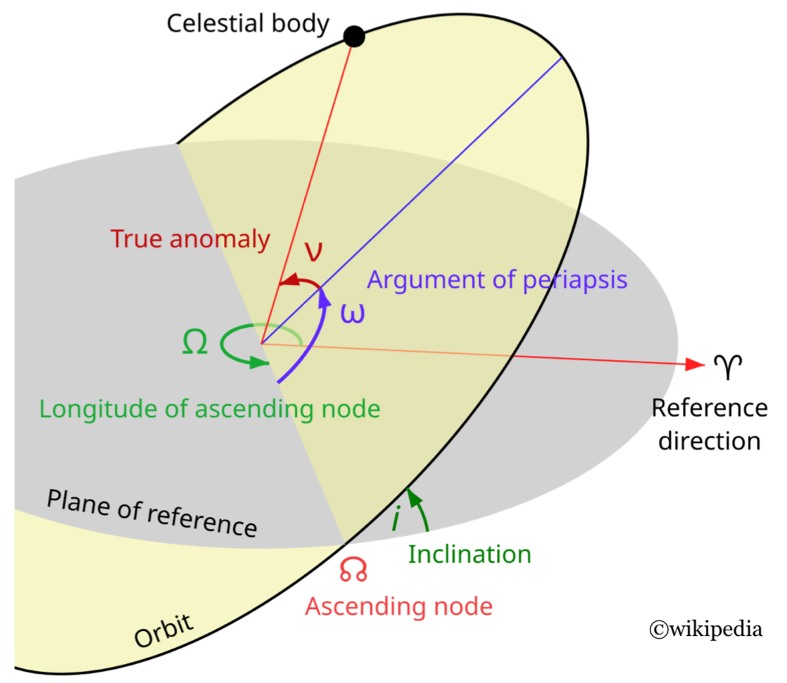

# [Minimum time orbit transfer](@id orbit)

```@setup main
using MINPACK
# hybrj (analytic Jacobian) is not available in every MINPACK build: fall back on hybrd.
function fsolve(f, j, x; kwargs...)
    try
        MINPACK.fsolve(f, j, x; kwargs...)
    catch e
        @warn "MINPACK hybrj failed, falling back on hybrd (finite differences)" exception = e
        MINPACK.fsolve(f, x; kwargs...)
    end
end
```

## Introduction

```@raw html

```

Minimum time control of the Kepler equation (CNES / TAS / Inria / CNRS collaboration,
check [^1] and [^2]):
```math
\begin{cases}
  t_f \to \min,\\
  \ddot{q} = -\mu\frac{q}{|q|^3} + \frac{T_{\max}}{m}\,u\,,\quad |u| \leq 1,\quad t \in [0,t_f],\\
  \dot{m} = -\beta T_{\max}|u|,
\end{cases}
```
where ``q \in \mathbf{R}^3`` is the position of the spacecraft, ``m`` its mass and ``u`` the thrust
direction, normalised by the maximum thrust ``T_{\max}``.

Fixed initial and final Keplerian orbits (free final longitude). Instead of ``(q, \dot{q})``,
the dynamics is written in *equinoctial elements* ``x = (P, e_x, e_y, h_x, h_y, L)``
(semilatus rectum, eccentricity vector, inclination vector and longitude), which are
regular for the elliptic orbits considered here. In these coordinates the system is
control-affine:
```math
\dot{x} = F_0(x) + \frac{T_{\max}}{m(t)} \sum_{i=1}^3 u_i F_i(x),
```
and, since the minimum time trajectory uses full thrust (``|u| = 1`` almost everywhere),
the mass is known in closed form, ``m(t) = m_0 - \beta T_{\max} t``. This is what is used below.

```@raw html

```

This page is a showcase of [OptimalControl.jl](https://control-toolbox.org/OptimalControl.jl):
the problem is described once with the `@def` macro, solved by a **direct method** with `solve`,
and the direct solution is then used to initialise an **indirect (shooting) method**
built on top of the same model with `Flow`.

```@example main
using OptimalControl
using NLPModelsIpopt
using OrdinaryDiffEq
using Plots
using MINPACK
using ForwardDiff
using LinearAlgebra
import CairoMakie as Mk   # 3D animation (qualified, to avoid clashes with Plots)
nothing # hide
```

## Problem definition

Units are Mm (``10^6`` m), hours and kg, so that thrusts in Newtons are converted
with ``3600^2 / 10^6``.

```@example main
const mass0 = 1500                               # Initial mass of the spacecraft (kg)
const β = 1.42e-02                               # Engine specific impulsion
const μ = 5165.8620912                           # Earth gravitation constant (Mm³/h²)
const P0 = 11.625                                # Initial semilatus rectum
const ex0, ey0 = 0.75, 0                         # Initial eccentricity vector
const hx0, hy0 = 6.12e-2, 0                      # Initial inclination vector
const L0 = π                                     # Initial longitude
const Pf = 42.165                                # Final semilatus rectum
const exf, eyf = 0, 0                            # Final eccentricity vector
const hxf, hyf = 0, 0                            # Final inclination vector
const Lf = 3π                                    # Estimation of final longitude for Tmax = 60
const x0 = [P0, ex0, ey0, hx0, hy0, L0]          # Initial state
const xf = [Pf, exf, eyf, hxf, hyf, Lf]          # Final state (L free: only used as a guess)

newton_to_internal(Tmax) = Tmax * 3600^2 / 1e6   # N → kg⋅Mm/h²

asqrt(x; ε=1e-9) = sqrt(sqrt(x^2+ε^2))           # Smooth sqrt, avoids issues with AD

function F0(x)
    P, ex, ey, hx, hy, L = x
    pdm = asqrt(P / μ)
    cl = cos(L)
    sl = sin(L)
    w = 1 + ex * cl + ey * sl
    return [0, 0, 0, 0, 0, w^2 / (P * pdm)]
end

function F1(x)
    P, ex, ey, hx, hy, L = x
    pdm = asqrt(P / μ)
    cl = cos(L)
    sl = sin(L)
    return pdm * [0, sl, -cl, 0, 0, 0]
end

function F2(x)
    P, ex, ey, hx, hy, L = x
    pdm = asqrt(P / μ)
    cl = cos(L)
    sl = sin(L)
    w = 1 + ex * cl + ey * sl
    return pdm * [2P / w, cl + (ex + cl) / w, sl + (ey + sl) / w, 0, 0, 0]
end

function F3(x)
    P, ex, ey, hx, hy, L = x
    pdm = asqrt(P / μ)
    cl = cos(L)
    sl = sin(L)
    w = 1 + ex * cl + ey * sl
    pdmw = pdm / w
    zz = hx * sl - hy * cl
    uh = (1 + hx^2 + hy^2) / 2
    return pdmw * [0, -zz * ey, zz * ex, uh * cl, uh * sl, zz]
end

nothing # hide
```

The optimal control problem is built by a function of the thrust, so that the same model
serves for both thrust levels considered below.

```@example main
function kepler(Tmax)
    T = newton_to_internal(Tmax)
    ocp = @def begin
        tf ∈ R, variable
        t ∈ [0, tf], time
        x = (P, ex, ey, hx, hy, L) ∈ R⁶, state
        u ∈ R³, control
        x(0) == x0
        x[1:5](tf) == xf[1:5]
        mass = mass0 - β * T * t
        ẋ(t) == F0(x(t)) + T / mass * (u₁(t) * F1(x(t)) + u₂(t) * F2(x(t)) + u₃(t) * F3(x(t)))
        u₁(t)^2 + u₂(t)^2 + u₃(t)^2 ≤ 1
        tf → min
    end
    return ocp
end
nothing # hide
```

## Direct solve, Tmax = 60 Newtons

The initial guess is a linear interpolation between the initial and final states.

```@example main
Tmax = 60                                    # Maximum thrust in Newtons
tf = 15                                      # Estimation of final time
x(t) = x0 + (xf - x0) * t / tf               # Linear interpolation
u = [0.1, 0.5, 0.]                           # Initial guess for the control
nlp_init = (state=x, control=u, variable=tf) # Initial guess for the NLP

ocp = kepler(Tmax)
nlp_sol = solve(ocp; init=nlp_init, grid_size=100)
nothing # hide
```

```@example main
tf_direct = variable(nlp_sol)
p  = costate(nlp_sol)
p0 = p(0)
println("Direct method: tf = ", tf_direct, " h")
plot(nlp_sol)
```

## Shooting (1/2), Tmax = 60 Newtons

The maximising control is regular and given by the normalised projection of the costate
on the control vector fields. A flow is built from the OCP and this feedback.

```@example main
function ur(t, x, p, tf) # Regular maximising control
    H1 = p' * F1(x)
    H2 = p' * F2(x)
    H3 = p' * F3(x)
    u = [H1, H2, H3]
    return u / norm(u)
end

fr = Flow(ocp, ur) # Regular flow (control feedback version)
nothing # hide
```

The unknowns are the final time and the initial costate (7 unknowns), the equations are the
5 final conditions on the state, the transversality condition on the free final longitude,
and a normalisation of the initial costate (``|p(0)| = 1``), valid since the final time is free.

```@example main
function make_shooting(flow)
    function shoot(ξ::Vector{S}) where S
        tf, p0 = ξ[1], ξ[2:end]
        xf_, pf = flow(0, x0, p0, tf)
        s = zeros(S, 7)
        s[1:5] = xf_[1:5] - xf[1:5]
        s[6] = pf[6]
        s[7] = sum(abs2, p0) - 1
        return s
    end
    jshoot(ξ) = ForwardDiff.jacobian(shoot, ξ)
    shoot!(s, ξ) = (s[:] = shoot(ξ); nothing)
    jshoot!(js, ξ) = (js[:] = jshoot(ξ); nothing)
    return shoot, shoot!, jshoot!
end

shoot, shoot!, jshoot! = make_shooting(fr)

p0 = p0 / norm(p0)      # Normalisation |p0| = 1 for free final time
ξ = [tf_direct; p0]     # Initial guess from the direct solution
bvp_sol = fsolve(shoot!, jshoot!, ξ; show_trace=true)
println("Converged: ", bvp_sol.converged, ", |s(ξ)| = ", norm(shoot(bvp_sol.x)))
println("Shooting: tf = ", bvp_sol.x[1], " h (direct: ", tf_direct, " h)")
```

## Shooting (2/2), Tmax = 0.7 Newtons

For a low thrust, the transfer takes many revolutions around the Earth. Shooting is then
the natural tool, provided a good initial guess is available: the one used below is hard-coded
(such guesses are classically obtained by a continuation on the thrust, see [^2]).
A flow is now built directly from the maximised Hamiltonian, which is the same model as
before with the control eliminated.

```@example main
Tmax = 0.7                                  # Maximum thrust (Newtons)
T = newton_to_internal(Tmax)

hr = OptimalControl.Hamiltonian((t, x, p) -> begin  # Regular maximised Hamiltonian
    H0 = p' * F0(x)
    H1 = p' * F1(x)
    H2 = p' * F2(x)
    H3 = p' * F3(x)
    mass = mass0 - β * T * t
    return H0 + T / mass * sqrt(H1^2 + H2^2 + H3^2)
end; autonomous=false)
fh = Flow(hr)

shoot, shoot!, jshoot! = make_shooting(fh)

tf = 1.210e3
p0 = -[-2.215319700438820e+01, -4.347109477345140e+01, 9.613188807286992e-01,
        3.181800985503019e+02, -2.307236094862410e+00, -5.797863110671591e-01]
p0 = p0 / norm(p0)      # Normalisation |p0| = 1 for free final time
ξ = [tf; p0]            # Initial guess
bvp_sol = fsolve(shoot!, jshoot!, ξ; show_trace=true)
println("Converged: ", bvp_sol.converged, ", |s(ξ)| = ", norm(shoot(bvp_sol.x)))
println("Shooting: tf = ", bvp_sol.x[1], " h")
```

## Plots

First, the positions in Cartesian coordinates are recovered from the equinoctial elements.

```@example main
tf = bvp_sol.x[1]
p0 = bvp_sol.x[2:end]
ode_sol = fh((0, tf), x0, p0)

# Cartesian position (Mm) from equinoctial elements
function position(P, ex, ey, hx, hy, L)
    cL, sL = cos(L), sin(L)
    w = 1 + ex * cL + ey * sL
    Z = hx * sL - hy * cL
    C = 1 + hx^2 + hy^2
    return [P * ((1 + hx^2 - hy^2) * cL + 2hx * hy * sL) / (C * w),
            P * ((1 - hx^2 + hy^2) * sL + 2hx * hy * cL) / (C * w),
            2P * Z / (C * w)]
end
nothing # hide
```

The trajectory is then displayed with [Makie](https://docs.makie.org) as an animated 3D scene:
the Earth, the initial and final orbits and the spacecraft trajectory (coloured by time),
seen by a moving camera that rotates around the Earth, tilts, and zooms out as the orbit
grows.

```@example main
# Sample the trajectory uniformly in time
ts   = range(0, tf, length=3000)
traj = [position(ode_sol(t)[1:6]...) for t in ts]
pts  = Mk.Point3f[Mk.Point3f(q...) for q in traj]

# Initial and final orbits (osculating ellipses)
Ls     = range(0, 2π, length=400)
orbit0 = Mk.Point3f[Mk.Point3f(position(P0, ex0, ey0, hx0, hy0, L)...) for L in Ls]
orbitf = Mk.Point3f[Mk.Point3f(position(Pf, exf, eyf, hxf, hyf, L)...) for L in Ls]

# Distance of the camera: follows the largest radius reached so far
rmax = accumulate(max, norm.(traj))

function animate_transfer(filename; nframes=120, fps=24, size=(480, 480))
    fig = Mk.Figure(; size, backgroundcolor=:black)
    k   = Mk.Observable(1)                                   # current trajectory index
    ttl = Mk.lift(k -> "Orbit transfer, t = $(round(Int, ts[k])) h of $(round(Int, tf)) h", k)
    ls  = Mk.LScene(fig[1, 1]; show_axis=false)
    Mk.Label(fig[1, 1], ttl; color=:white, fontsize=16, valign=:top, tellwidth=false, tellheight=false)

    # scene
    Mk.mesh!(ls, Mk.Sphere(Mk.Point3f(0), 6.378f0); color=:royalblue, shading=Mk.NoShading)
    Mk.lines!(ls, orbit0; color=:gray70, linestyle=:dash, linewidth=1.5)
    Mk.lines!(ls, orbitf; color=:seagreen3, linestyle=:dash, linewidth=1.5)
    Mk.lines!(ls, Mk.lift(k -> pts[1:k], k);
        color=Mk.lift(k -> ts[1:k], k), colormap=:plasma, colorrange=(0, tf), linewidth=1)
    Mk.scatter!(ls, Mk.lift(k -> [pts[k]], k); color=:white, markersize=10)

    # camera path: one turn around the Earth, tilt oscillation, zoom out with the orbit
    function camera!(s, i)
        az   = π/4 + 2π * s
        el   = deg2rad(25 + 20 * sin(2π * s))
        dist = 2.3 * rmax[i] + 20 * (1 - s)
        eye  = dist * Mk.Vec3f(cos(el) * cos(az), cos(el) * sin(az), sin(el))
        Mk.update_cam!(ls.scene, eye, Mk.Vec3f(0), Mk.Vec3f(0, 0, 1))
    end

    Mk.record(fig, filename, 1:nframes; framerate=fps, px_per_unit=1) do f
        s = (f - 1) / (nframes - 1)
        i = max(1, round(Int, 1 + (length(ts) - 1) * min(1, s / 0.85)))  # hold the end of the transfer
        k[] = i
        camera!(s, i)
    end
    return filename
end

animate_transfer("orbit_transfer.gif")
nothing # hide
```


## Reproducibility

```@setup main
using Pkg
using InteractiveUtils
using Markdown

# Download links for the benchmark environment
function _downloads_toml(DIR)
    link_manifest = joinpath("assets", DIR, "Manifest.toml")
    link_project = joinpath("assets", DIR, "Project.toml")
    return Markdown.parse("""
    You can download the exact environment used to build this documentation:
    - 📦 [Project.toml]($link_project) - Package dependencies
    - 📋 [Manifest.toml]($link_manifest) - Complete dependency tree with versions
    """)
end
```

```@example main
_downloads_toml(".") # hide
```

```@raw html
<details style="margin-bottom: 0.5em; margin-top: 1em;"><summary>ℹ️ Version info</summary>
```

```@example main
versioninfo() # hide
```

```@raw html
</details>
```

```@raw html
<details style="margin-bottom: 0.5em;"><summary>📦 Package status</summary>
```

```@example main
Pkg.status() # hide
```

```@raw html
</details>
```

```@raw html
<details style="margin-bottom: 0.5em;"><summary>📚 Complete manifest</summary>
```

```@example main
Pkg.status(; mode = PKGMODE_MANIFEST) # hide
```

```@raw html
</details>
```

## References

[^1]: Bonnard, B.; Caillau, J.-B.; Trélat, E. Geometric optimal control of elliptic Keplerian orbits.  *Discrete Contin. Dyn. Syst. Ser. B* **5** (2005), no. 4, 929-956.

[^2]: Caillau, J.-B.; Gergaud, J.; Noailles, J. 3D Geosynchronous Transfer of a Satellite: continuation on the Thrust. *J. Optim. Theory Appl.* **118** (2003), no. 3, 541-565.
